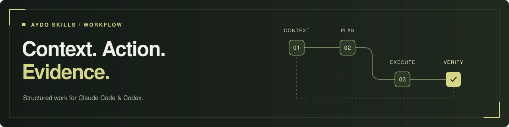
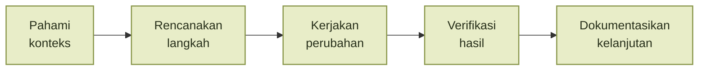

# AYDO Skills

**Alur kerja yang jelas untuk pengembangan software bersama AI.**

AYDO Skills mengembangkan skill dan panduan kerja untuk membantu manusia berkolaborasi dengan **Claude Code** dan **Codex**. Kami berfokus pada pekerjaan yang terstruktur, hasil yang dapat diperiksa, dan konteks yang mudah dilanjutkan.

[Pendekatan](#pendekatan) · [Alur kerja](#alur-kerja) · [Fokus](#fokus) · [Prinsip](#prinsip) · [Kontak](#kontak)

## Pendekatan

Skill menghubungkan kebutuhan dengan cara kerja proyek: memahami konteks, menentukan langkah yang sesuai, lalu memeriksa hasilnya. Panduan yang relevan digunakan sesuai kebutuhan pekerjaan.

Manusia menentukan tujuan, memilih model, dan mengambil keputusan penting. Skill membantu menjaga langkah dan konteks tetap jelas sepanjang proses.

## Alur kerja

Alur ini menggambarkan pendekatan kerja kami. Kedalaman perencanaan dan pemeriksaan disesuaikan dengan ukuran serta dampak perubahan.

## Fokus

| Area | Tujuan |
| :--- | :--- |
| **Pekerjaan terstruktur** | Membuat tujuan, langkah, dan cara memeriksa hasil mudah dipahami. |
| **Pengembangan aplikasi** | Mengikuti aturan, tool, dan lingkungan yang digunakan proyek. |
| **Dokumentasi** | Menjelaskan konteks dan alur sistem agar berguna bagi manusia maupun AI. |
| **Kelanjutan pekerjaan** | Menyimpan keputusan dan langkah berikutnya agar pekerjaan mudah dilanjutkan. |

## Prinsip

- **Konteks lebih dulu.** Pahami kebutuhan dan kondisi proyek sebelum mengubahnya.
- **Hasil yang dapat diperiksa.** Catat apa yang dikerjakan dan bagaimana hasilnya diverifikasi.
- **Detail sesuai kebutuhan.** Gunakan struktur yang membantu pekerjaan tetap jelas dan mudah diikuti.
- **Kendali pada pengguna.** Tujuan, pilihan model, dan keputusan penting tetap berada pada manusia.

## Kontak

Dikelola oleh **Adi Yudhanegara**.

| Kanal | Alamat |
| :--- | :--- |
| Email | [adi.yudhanegaradona@gmail.com](mailto:adi.yudhanegaradona@gmail.com) |
| WhatsApp | [+62 896-5104-6251](https://wa.me/6289651046251) |
| LinkedIn | [linkedin.com/in/adiyudhanegara](https://www.linkedin.com/in/adiyudhanegara) |
| Instagram | [@adiyudhanegara](https://www.instagram.com/adiyudhanegara) |
| Facebook | [facebook.com/adiyudhanegara](https://www.facebook.com/adiyudhanegara) |

---

AYDO Skills · Context. Action. Evidence.
